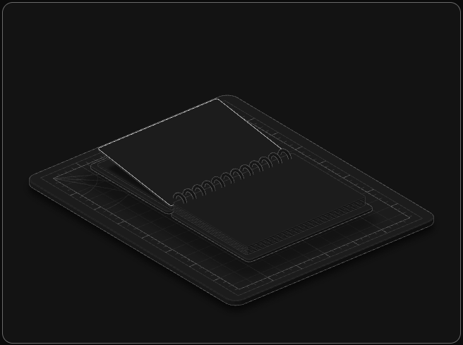
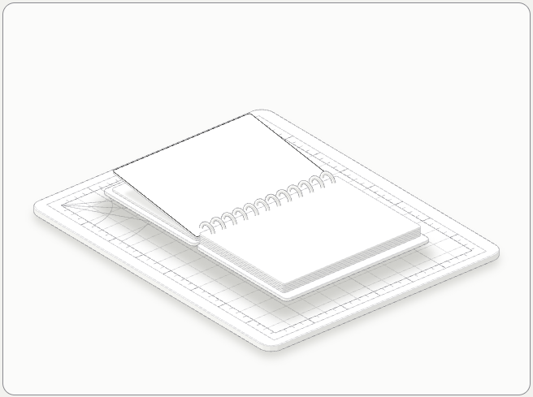

# hairline-anatomy

An agent skill that builds **detailed, interactive isometric figures** of real machines (an easel, a camera, a lock, a sketchbook on a cutting mat) as SVG, with optional WebGL light and 3D, and makes them answer the pointer the [Hairline](https://github.com/lucasmarkes/hairline) way.

It joins two MIT projects: [anatomy](https://github.com/wheresryan22/anatomy) (the object, the drawing kit, the audits) and Hairline (the interaction rules). The output is one standalone HTML file, or figures that sit inside your own page and take its colours in light and dark.

<p>
  
  
</p>

## What you get

- A real object built from 40 to 150 small, precise parts, not a diagram.
- Interaction that follows seven rules: hit areas that never move, motion that spreads out from the pointer, two clocks (a spring for "where", a tween for "which"), one lit accent, a designed rest pose, a loop that sleeps when nothing moves, and a clamped reach.
- A plain framed card with no on-screen words. Labels live in `aria-label` and `aria-valuetext`, and keyboard control is built in.
- Checks that run in headless Chrome: interaction, loose line ends, painter's order, reduced motion, console errors.

## Requirements

- Node 20.10 or later. No dependencies, no install step.
- Chrome or Chromium for the check scripts (optional). Set `CHROME_PATH` if it is not found.

## Install

The skill is a folder with a `SKILL.md` at its root, the [Agent Skills](https://agentskills.io) layout.

**Claude Code**

```bash
git clone https://github.com/kaushikhegde11/hairline-anatomy ~/.claude/skills/hairline-anatomy
```

**Other agents and LLMs.** Clone the repo anywhere, then point your agent at it: tell it to read `SKILL.md` first, then `interaction.md`. `AGENTS.md` has the same instruction for tools that read it automatically. The skill needs only file access and the ability to run Node; it does not depend on one vendor's tools.

## Use

Ask for a figure in plain words:

> Make an interactive isometric figure of a spiral sketchbook on a cutting mat. Sweeping the pointer along it turns the pages.

The skill offers two or three one-line concepts, waits for your pick, sizes the work (Figure, Hero or Epic), then builds a page and checks it.

## Examples

Build any example with Node and open the HTML it writes next to its build script.

| Example | What it shows |
| --- | --- |
| `examples/sketchbook` | A sweep that turns leaves, a wire spiral built from tubes, a float with a soft shadow on hover |
| `examples/dial-live` | One figure with a slider; every interaction rule on a dial indicator |
| `examples/landing-figures` | Four figures inside a host page, in the host's palette |
| `examples/dial-indicator`, `desk-computer`, `arcade-cabinet` | Anatomy's SVG examples |
| `examples/raptor-engine`, `ripple-tank` | WebGL inside the drawing |
| `examples/test-rig`, `spot-plate` | React production figures |
| `examples/turning-dial` | The optional 3D mode (beta) |

```bash
node examples/sketchbook/build.mjs
node scripts/interaction-check.mjs examples/sketchbook/sketchbook.html --out shots
```

## Layout

```
SKILL.md          workflow, craft rules, safety (read first)
interaction.md    the concept step and the seven interaction rules
kit/              drawing kit, interaction helpers, WebGL and 3D runtimes
references/       craft, kit API, motion, WebGL, 3D, verification
scripts/          headless-Chrome checks
examples/         runnable figures
```

## Safety

Everything runs locally and nothing is downloaded. The browser scripts open only local files or `localhost` and refuse other hosts unless you pass `--allow-remote`. `drive.mjs` can run JavaScript in the page it opens, so use it on pages you built. Chrome runs with a throwaway profile and its sandbox on. Details are in [SECURITY.md](SECURITY.md) and the Safety section of `SKILL.md`.

## Licence and credits

MIT, see [LICENSE](LICENSE) and [NOTICE.md](NOTICE.md). Built on [anatomy](https://github.com/wheresryan22/anatomy) by Ryan and [Hairline](https://github.com/lucasmarkes/hairline) by Lucas Marques. Not affiliated with or endorsed by either.
